# Dubai Location Intelligence Dashboard — Architecture

> Companion to `plan.md`. Defines the tools, tech stack and structure for an open-source, static dashboard hosted on **GitHub Pages**.

---

## 1. Design constraints

| Constraint | Consequence |
|---|---|
| Hosted on GitHub Pages (static only) | No backend, no database server. All data is pre-processed into static files at build time. |
| Free and open source | Only free tiers and open-source libraries. No map tokens, no paid APIs required to view the site. |
| No secrets in the browser | AI memos are generated in CI (API key in GitHub Secrets), not in the visitor's browser. |
| GitHub Pages size limits | Keep published site well under 1 GB and every file under 100 MB. Target: < 150 MB total. |
| Fast on mobile | Small aggregates for first view; heavier data loaded lazily per page. |
| Reproducible | Anyone can clone the repo and rebuild the data from public sources with one command. |

---

## 2. High-level architecture

```mermaid
flowchart LR
  subgraph Sources[Public data sources]
    DLD[DLD open data\nsales, rents, projects, units]
    DP[Dubai Pulse\nboundaries, population, stations, parks]
    OSM[OpenStreetMap\namenities]
  end

  subgraph Pipeline[Data pipeline - Python, runs in GitHub Actions]
    F[fetch] --> C[clean + crosswalk]
    C --> S[spatial enrich\nboundaries, H3, distances]
    S --> A[aggregate KPIs\nDuckDB]
    A --> V[validate\nPandera tests]
    V --> M[AI memos\nClaude API]
  end

  subgraph Static[Static outputs]
    J[JSON KPI snapshots]
    P[Parquet tables]
    G[GeoJSON / PMTiles]
    MM[memos.json]
  end

  subgraph Web[Frontend - Vite + React + TS]
    UI[Pages, cards, charts]
    MAP[MapLibre + deck.gl]
    DB[DuckDB-WASM\nin-browser queries]
  end

  Sources --> F
  M --> Static
  A --> Static
  Static --> Web
  Web --> GH[GitHub Pages]
```



**Flow:** a scheduled GitHub Action fetches public data → cleans and enriches it → computes KPIs → validates → generates AI memos → writes static files → builds the frontend → deploys to GitHub Pages.

---

## 3. Repository structure

```
dubai-location-intel/
├── README.md
├── LICENSE                     # MIT for code
├── DATA_LICENSE.md             # attribution for DLD, Dubai Pulse, OSM
├── plan.md
├── architecture.md
├── pipeline/                   # Python data pipeline
│   ├── pyproject.toml
│   ├── src/dli/
│   │   ├── fetch/              # one module per source
│   │   ├── clean/
│   │   ├── spatial/
│   │   ├── aggregate/          # DuckDB SQL files
│   │   ├── validate/           # Pandera schemas
│   │   ├── memos/              # prompt + generation + fact-check
│   │   └── export/             # writes JSON / Parquet / GeoJSON / PMTiles
│   ├── sql/                    # KPI queries, one file per KPI group
│   └── tests/
├── data/
│   ├── reference/              # community_crosswalk.csv, aliases, category maps (committed)
│   ├── raw/                    # downloaded sources (git-ignored)
│   └── interim/                # cleaned tables (git-ignored)
├── web/                        # Frontend app
│   ├── package.json
│   ├── vite.config.ts
│   ├── public/data/            # pipeline outputs copied here at build time
│   └── src/
│       ├── pages/              # MarketPulse, Explorer, Rental, Supply, SiteAnalyst, Screener, About
│       ├── components/         # KpiCard, ChartCard, MapView, Filters, MemoPanel
│       ├── charts/             # ECharts option builders
│       ├── map/                # MapLibre + deck.gl layers
│       ├── data/               # loaders, DuckDB-WASM client, types
│       ├── state/              # Zustand store + URL sync
│       └── styles/
└── .github/workflows/
    ├── data-refresh.yml        # weekly pipeline + memos
    ├── deploy.yml              # build + deploy to Pages
    └── ci.yml                  # lint, typecheck, tests on PRs
```

---

## 4. Data pipeline stack

| Need | Tool | Why |
|---|---|---|
| Language & env | **Python 3.12** + **uv** | Fast, reproducible environments |
| HTTP fetching | `httpx` with retries + on-disk caching | Polite, resumable downloads |
| Core processing | **DuckDB** (with `spatial` extension) | Fast SQL on large CSVs, spatial joins, writes Parquet directly |
| Dataframes where needed | **Polars** | Fast cleaning steps outside SQL |
| Geometry | **GeoPandas**, **Shapely** | Boundary cleaning, centroids, areas, buffers |
| Name matching | **RapidFuzz** | Fuzzy DLD ↔ Dubai Municipality community matching |
| Hex grid | **h3-py** | Amenity density hexagons |
| OSM extraction | **Overpass API** (Dubai bounding box, results cached) or Geofabrik GCC extract + **pyosmium** | Amenity points by category |
| Distances | DuckDB spatial / Shapely (projected CRS: UTM zone 40N, EPSG:32640) | Accurate metre distances |
| Map simplification | **mapshaper** (CLI) | Small, fast community boundary files |
| Vector tiles (optional) | **tippecanoe** → **PMTiles** | Only if point layers get too heavy for GeoJSON |
| Validation | **Pandera** schemas + **pytest** | Fail the build on bad data |
| AI memos | **Anthropic Python SDK** (Claude model, e.g. Sonnet tier) | Memo generation in CI |
| Orchestration | Simple CLI (`dli run all`) via **Typer** | One command locally and in CI |

### Pipeline stages
1. **fetch** — download raw files to `data/raw/` with date-stamped names; record source URL + timestamp in `manifest.json`.
2. **clean** — apply rules from `plan.md` §5; residential filter; outlier removal; unit conversion.
3. **crosswalk** — map DLD areas → Dubai Municipality communities using `data/reference/community_crosswalk.csv`; unmatched names fail the build with a report.
4. **spatial enrich** — centroids, land area, metro distances, amenity counts per community and per H3 cell (resolution 8).
5. **aggregate** — one SQL file per KPI group; outputs monthly × community × type × bedroom cubes.
6. **validate** — schema checks, row-count sanity, range checks (e.g. yield 1–15%), suppression of small samples.
7. **memos** — generate memos for eligible communities; run fact-check; write `memos.json`.
8. **export** — write web-ready files (below) and a `build_info.json` with "data through" date.

### Output files (served from `/data/`)

| File | Format | Approx size target | Used by |
|---|---|---|---|
| `build_info.json` | JSON | < 5 KB | All pages |
| `city_monthly.json` | JSON | < 300 KB | Market Pulse |
| `community_kpis.json` | JSON | < 500 KB | Explorer, Rental, Screener, Site Analyst |
| `communities.geojson` | GeoJSON (simplified) | < 2 MB | All maps |
| `stations.geojson`, `parks.geojson` | GeoJSON | < 300 KB | Map layers |
| `amenities_h3.json` | JSON | < 1 MB | Hex layer, Site Analyst |
| `amenities.parquet` | Parquet | < 10 MB | Radius queries in Site Analyst |
| `sales_monthly_cube.parquet` | Parquet | < 30 MB | Filtered queries via DuckDB-WASM |
| `rents_monthly_cube.parquet` | Parquet | < 20 MB | Filtered queries via DuckDB-WASM |
| `projects.parquet` | Parquet | < 5 MB | Supply page |
| `comps_recent.parquet` | Parquet | < 30 MB | Site Analyst comps (no unit identifiers) |
| `memos.json` | JSON | < 2 MB | Site Analyst |

---

## 5. Frontend stack

| Need | Tool | Why |
|---|---|---|
| Build tool | **Vite** | Fast dev server, simple static build |
| Framework | **React 18 + TypeScript** | Large ecosystem, strong typing, works well with Claude Code |
| Routing | **React Router** with **HashRouter** | Avoids 404s on refresh on GitHub Pages |
| Styling | **Tailwind CSS** + CSS variables for theme tokens | Fast, consistent, easy dark mode |
| UI primitives | **Radix UI** (via shadcn/ui components) | Accessible drawers, tabs, selects, tooltips |
| State | **Zustand** + URL query sync | Shared filters, shareable links |
| Charts | **Apache ECharts** (`echarts-for-react`) | Widest chart variety: combo, scatter, heatmap calendar, radar, treemap |
| Map engine | **MapLibre GL JS** | Open source, no token required |
| Advanced map layers | **deck.gl** (H3HexagonLayer, GeoJsonLayer extrusion, ScatterplotLayer) | Hex grids and 3D views for demo variety |
| Basemap tiles | **OpenFreeMap** (free OSM vector tiles) or self-hosted **Protomaps PMTiles** extract for Dubai | No API keys; PMTiles keeps the site fully self-contained |
| Client-side spatial | **Turf.js** | Radius buffers, point-in-polygon for dropped pins |
| In-browser SQL | **DuckDB-WASM** | Query Parquet files with filters without a server |
| Data fetching/cache | **TanStack Query** | Cached, lazy loading per page |
| Number/date formatting | `Intl.NumberFormat`, **date-fns** | Consistent AED and date formats |
| Export | **html-to-image** (PNG), **jsPDF** (PDF) | Site summary download |
| Markdown memo rendering | **react-markdown** | Display AI memos |

### Loading strategy
- First view loads only `build_info.json`, `city_monthly.json` and `community_kpis.json`.
- Map pages lazy-load GeoJSON and map libraries (code-split per route).
- DuckDB-WASM loads only when a page needs filtered queries (Rental, Screener, Site Analyst comps).
- Parquet files fetched via HTTP range requests where possible.

---

## 6. AI memo approach

| Option | Used? | Notes |
|---|---|---|
| **A. Pre-generated in CI** | **Primary** | Claude API called in the `data-refresh` workflow; key stored in GitHub Secrets; output committed as `memos.json`. Visitors pay nothing, no key exposed. |
| B. Bring-your-own-key, live | Optional (v1.1) | For custom pins: visitor pastes their own API key, stored only in session memory, request sent directly from browser. Clearly labelled; off by default. |
| C. Template narrative fallback | Yes | Rule-based text from KPIs when a memo is missing or fails checks. |

**Prompting rules**
- System prompt fixes structure, length and tone (see `plan.md` §10).
- Input is a compact JSON of computed facts only.
- Temperature low; ask the model to cite only numbers present in input.

**Fact-check step**
- Extract all numbers from the memo; each must match a value in the input JSON (with formatting tolerance). Failures → regenerate once → else fall back to template.

**Cost control**
- Regenerate a memo only when its input JSON hash changes.
- Cap the number of memos per run.

---

## 7. Hosting, CI/CD and automation

| Workflow | Trigger | Steps |
|---|---|---|
| `ci.yml` | Pull requests | Python lint (**ruff**), tests (**pytest**); web lint (**ESLint**), typecheck (`tsc`), unit tests (**Vitest**) |
| `data-refresh.yml` | Weekly schedule + manual | Set up uv → `dli run all` → upload outputs as artifact → open PR or commit to `data` branch |
| `deploy.yml` | Push to `main` / after data refresh | `npm ci` → copy pipeline outputs into `web/public/data` → `vite build` → deploy with **actions/deploy-pages** |

**GitHub Pages setup**
- Source: GitHub Actions.
- Vite `base` set to the repo subpath (e.g. `/dubai-location-intel/`).
- Optional custom subdomain later (e.g. a subdomain of surabhigeo.com via CNAME).

**Large data handling**
- Raw data never committed.
- Published outputs stay under the size targets; if they grow, move large Parquet files to **GitHub Releases** assets and fetch at runtime, or partition by year.

---

## 8. Performance and quality budgets

| Metric | Target |
|---|---|
| Initial JS (gzipped) | < 300 KB before map routes |
| First view (Market Pulse) | < 3 s on mid-range mobile, 4G |
| Map interaction | 60 fps on laptop, 30+ fps on mobile |
| Lighthouse | Performance ≥ 85, Accessibility ≥ 95 |
| Total published data | < 150 MB |

**Quality checks**
- Pipeline: schema tests, sample-size suppression, crosswalk completeness report.
- Frontend: Vitest for data utilities (formatting, KPI calcs), a few **Playwright** smoke tests (each page renders, map loads, filters update cards).

---

## 9. Licensing and attribution

| Item | License / requirement |
|---|---|
| Project code | MIT |
| DLD / Dubai Pulse data | Open data with attribution (verify exact terms in Phase 0) |
| OpenStreetMap data | ODbL — "© OpenStreetMap contributors"; derived amenity database shared under ODbL |
| Basemap | Attribution per tile provider (OpenFreeMap / Protomaps + OSM) |
| AI memos | Labelled "AI-generated from public data, not investment advice" |

Attribution appears in the map corner, the footer of every page and `DATA_LICENSE.md`.

---

## 10. Development tooling

| Purpose | Tool |
|---|---|
| Building with AI | **Claude Code** |
| Editor | VS Code |
| Python env | uv, ruff, pytest |
| JS env | Node 20 LTS, npm, ESLint, Prettier, Vitest, Playwright |
| GIS checks | QGIS (visual QA of boundaries, joins, distances) |
| Data exploration | DuckDB CLI, Jupyter (optional, not shipped) |
| Design | Figma or quick mockups before building each page |
| Demo recording | Screen recorder for the 60–90 s LinkedIn video |

---

## 11. Running costs

| Item | Cost |
|---|---|
| GitHub repo, Actions (public repo), Pages | Free |
| Data sources | Free |
| Basemap (OpenFreeMap / self-hosted PMTiles) | Free |
| Claude API for memos | Small, pay-as-you-go; only regenerated when data changes |
| Custom domain (optional) | Existing surabhigeo.com |

---

## 12. Risks and mitigations

| Risk | Mitigation |
|---|---|
| Dubai Pulse access changes or requires registration | Cache last good raw files; support multiple fetch routes (gateway + bulk) |
| Community name mismatches | Maintained crosswalk with build-failing report for unmatched names |
| Data files exceed Pages limits | Aggregate further, partition by year, or use Release assets |
| Misleading metrics from small samples | Minimum-record thresholds and "limited data" badges |
| AI memo states wrong numbers | Numeric fact-check + template fallback |
| Overpass API rate limits | Cache results; use Geofabrik extract as fallback |
| Perceived as investment advice | Clear disclaimers on Site Analyst, Screener and memos |
